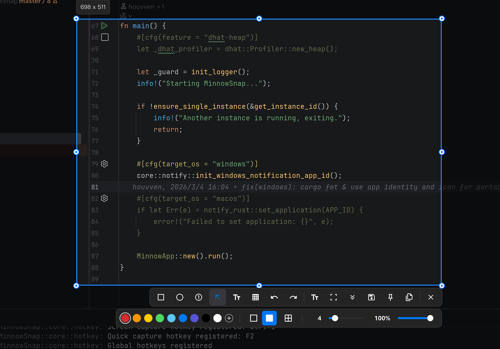

# MinnowSnap

Desktop screenshots, annotations, scroll capture, local OCR, QR detection and pinned images.



## Build

Use the toolchain pinned in `rust-toolchain.toml`. macOS builds require Xcode
and its Metal Toolchain (`xcodebuild -downloadComponent MetalToolchain`).

```sh
cargo run -p minnow-app
cargo build --locked -p minnow-app --release
cargo build --locked -p minnow-app --features portable --release
cargo build --locked -p minnow-app --no-default-features --release
python3 scripts/bundle.py --profile release
```

Portable builds store configuration, logs and models in `data/` beside the executable.
Default builds include local OCR; `--no-default-features` builds retain screenshots
and QR detection without the local OCR runtime.
Packages include a build manifest; filenames distinguish target, profile,
data layout and resolved features.

## Workspace

| Package | Responsibility |
| --- | --- |
| `minnow-app` | CLI, composition, process lifetime and product resources |
| `minnow-application` | Use cases, sessions, jobs and adapter contracts |
| `minnow-imaging` | Shared images and coordinate transforms |
| `minnow-capture` | Capture protocol and scroll stitching |
| `minnow-editor` | Annotations, history and CPU rasterization |
| `minnow-settings` | Settings schema and persistence |
| `minnow-recognition` | OCR/QR and model lifecycle |
| `minnow-platform` | Native capture, clipboard, export and OS integration |
| `minnow-ui` | GPUI features, presentation and windowing |

`scripts/` contains packaging and development commands. `.github/` contains CI
and dependency-update automation. Resources stay with their owning package.

## Scroll capture

Scroll capture aligns successive observations against the last verified frame,
then commits a pixel-verified seam. Ambiguous or missing overlap is reported;
finishing in that state retains a partial image with an incomplete result.
See [the capture architecture](crates/minnow-capture/README.md) for ownership,
resource limits, recovery behavior and replay coverage.

On macOS, scrolling capture requires macOS 14 or newer and Screen Recording
permission. It uses a ScreenCaptureKit session that excludes this application's
windows. Single screenshots continue to use the existing capture backend.

## Checks

```sh
cargo fmt --all --check
cargo clippy --locked --workspace --all-targets --all-features -- -D warnings
cargo test --locked --workspace --all-features
```

## Credits

[GPUI](https://github.com/zed-industries/zed/tree/main/crates/gpui) ·
[xcap](https://github.com/nashaofu/xcap) ·
[PaddleOCR](https://github.com/PaddlePaddle/PaddleOCR)
